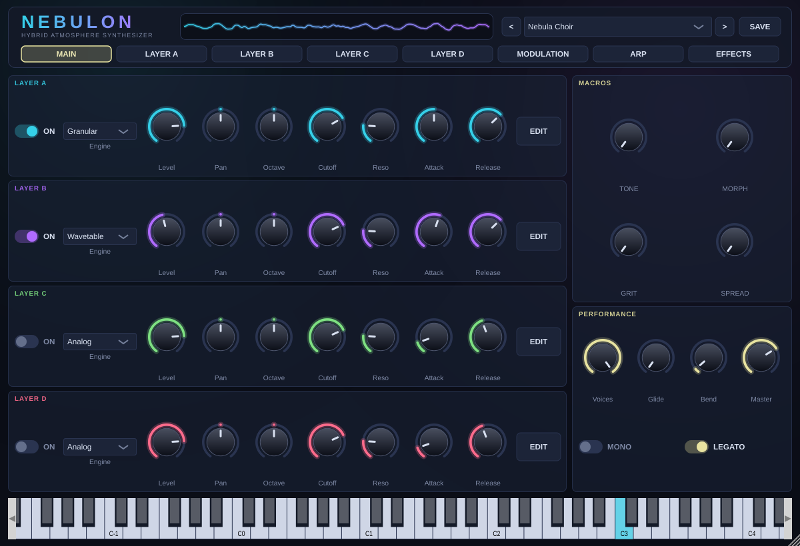
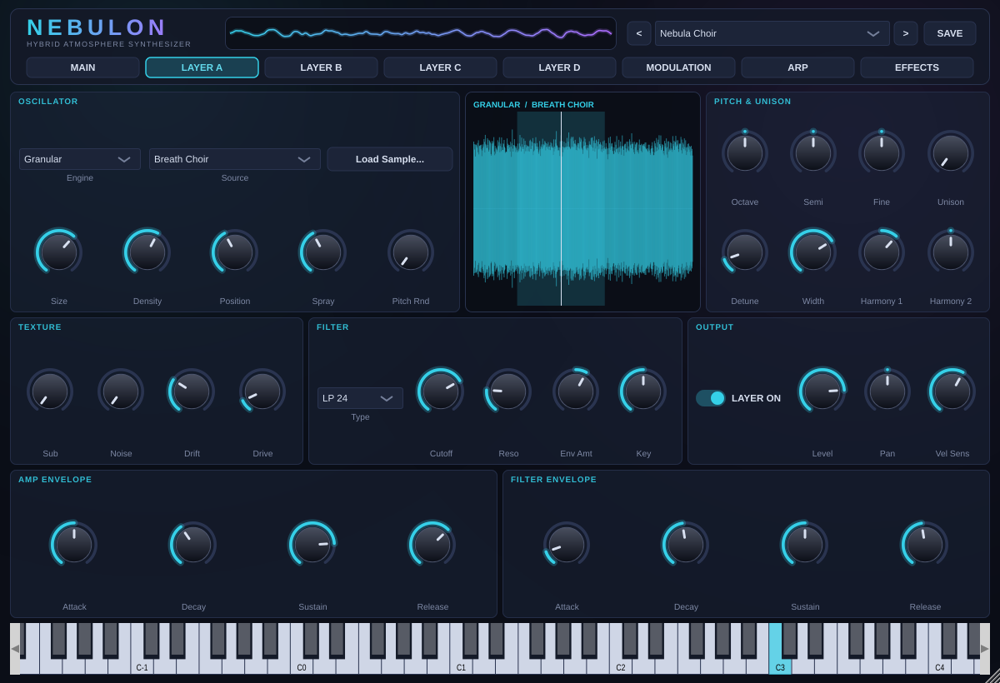
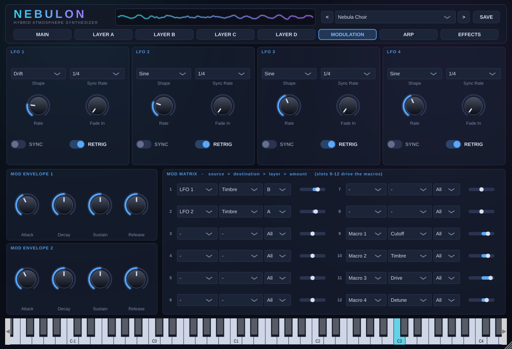
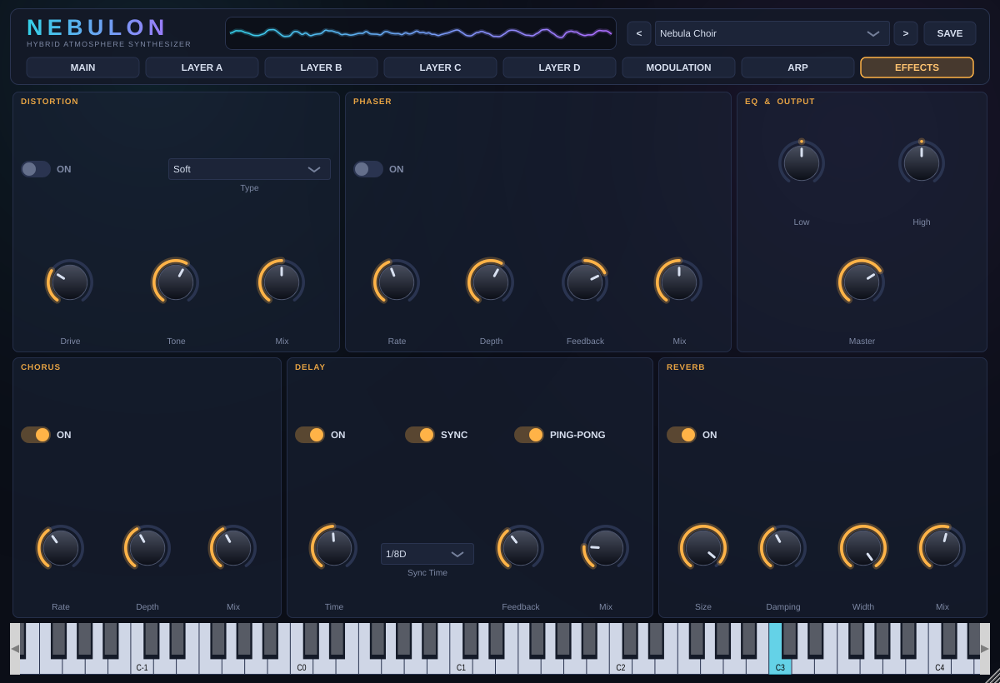

# Nebulon — Hybrid Atmosphere Synthesizer

An original, open-source polyphonic synth plugin (VST3 / AU / Standalone) for cinematic pads,
evolving textures, granular soundscapes, keys, basses, leads and arps. It's in the same
category as big "hybrid" synth workstations, but all of its code, sound engines, UI and
presets are its own.



## What it can do

### 4 layers × 5 sound engines
Each of the four layers (A–D) is a complete synth with its own engine, filter and envelopes:

| Engine | What it does |
|---|---|
| **Analog** | Anti-aliased oscillator that morphs Sine → Triangle → Saw → Square |
| **Wavetable** | 9 built-in morphing tables (Classic, Pulse Width, Vowel, Harmonic Sweep, Hard Sync, Digital Bells, Drawbar Organ, Spectral Growl, Crystal Dust), mip-mapped for alias-free playback |
| **FM** | Two-operator phase modulation with ratio, amount and feedback |
| **Granular** | Grain clouds with size, density, position, spray and pitch randomisation |
| **Sample** | Pitched playback with start point and crossfaded looping |

Granular and Sample can use **9 built-in source sounds** (Glass Bells, Breath Choir, Vocal Ooh,
Bowed Metal, Kalimba, Tape Strings, Crystal Shimmer, Ocean Wash, Vinyl Air) **or any audio file
you load** (WAV / AIFF / FLAC / MP3 / OGG, up to 60 s). Loaded samples are remembered in your
DAW project and in saved presets.



### Per layer
- Unison up to 7 voices with detune and stereo width
- **Two harmony voices** (±24 semitones) for instant chords, fifths and octaves
- Sub oscillator, noise, *analog drift* and drive
- **8 filter types**: LP12, LP24, Band, High, Notch, Comb +, Comb −, Vowel (formant)
- Amp and filter ADSR envelopes, velocity sensitivity, level and pan

### Modulation
- **4 LFOs**: 7 shapes (incl. S&H and smooth random drift), tempo sync, fade-in, retrigger or free-run
- **2 mod envelopes**
- **12-slot mod matrix**. Sources: LFOs, mod envelopes, velocity, mod wheel, aftertouch, key,
  per-note random, 4 macros. Destinations: pitch, cutoff, resonance, level, pan, *timbre*
  (wave shape / wavetable position / FM amount / grain position), detune, drive, sub,
  noise, grain size, grain density, filter-env amount. Each slot targets all layers or one.
- **4 macro knobs** (Tone, Morph, Grit, Spread), pre-wired through matrix slots 9–12 and re-routable



### Arpeggiator
Up, Down, Up/Down, Random, As Played, Chord · 1–4 octaves · rates from 4 bars to 1/32
(incl. dotted and triplet) · gate · swing · latch · locks to your DAW's tempo and bar grid.

### Effects rack
Distortion (Soft / Hard / Fold / Bitcrush) → 2-band EQ → Phaser → Chorus →
tempo-synced ping-pong Delay → Reverb → soft-clipping master.



### Performance
Polyphony 1–16 · Mono and Legato modes · Glide · pitch-bend range up to ±24 · on-screen keyboard.

### Presets
40 factory patches in 9 categories (Pads, Keys, Bass, Leads, Plucks, Arps, Drones, Textures,
Cinematic). **Save your own** with the SAVE button. They go to `Documents/Nebulon/Presets`
and show up under "User" in the browser. Factory patches also appear in your DAW's program list.

## Getting the plugin

Every push builds Windows, macOS and Linux binaries with GitHub Actions.
Open the repo's **Actions** tab → latest *Build* run → download `Nebulon-Windows`,
`Nebulon-macOS` or `Nebulon-Linux` from *Artifacts*. Then copy `Nebulon.vst3` to:

| OS | VST3 folder |
|---|---|
| Windows | `C:\Program Files\Common Files\VST3\` |
| macOS | `~/Library/Audio/Plug-Ins/VST3/` (AU: `~/Library/Audio/Plug-Ins/Components/`) |
| Linux | `~/.vst3/` |

On macOS the build is unsigned; if it's blocked, run
`xattr -dr com.apple.quarantine ~/Library/Audio/Plug-Ins/VST3/Nebulon.vst3`.
The **Standalone** app runs without a DAW (on-screen keyboard or a MIDI controller).

## Building yourself

Requires CMake ≥ 3.22 and a C++17 compiler; JUCE 8 is downloaded automatically.

```bash
cmake -B build -DCMAKE_BUILD_TYPE=Release
cmake --build build --config Release
```

Output lands in `build/Nebulon_artefacts/Release/`. Pass `-DJUCE_DIR=/path/to/JUCE` to use a
local JUCE. Add `-DNEBULON_BUILD_TESTS=ON` to build `NebulonRenderTest`, which renders every
preset to WAV (checking for silence / NaNs and reporting CPU cost), tests sample loading and
the arpeggiator, and snapshots every UI page.

## Project layout

```
Source/Engine.*              voice: 5 engines, unison/harmony, filters, envelopes, LFOs, mod matrix;
                             synth with polyphony limit, mono/legato, glide
Source/Wavetables.*          wavetable generation (FFT mip-maps)
Source/Sources.*             built-in granular/sample source sounds
Source/Arpeggiator.h         tempo-synced arpeggiator
Source/FxChain.h             effects rack
Source/DSP.h                 SVF, comb, biquad, PolyBLEP oscillators
Source/Params.h              shared enums and name lists
Source/PluginProcessor.*     parameters, presets, sample loading, state
Source/Presets.h             factory patches
Source/PluginEditor.*        window, header, tabs, preset browser, scope
Source/Pages.*               Main / Layer / Modulation / Arp / Effects pages
Source/Controls.h            knob, choice, toggle and panel widgets
Source/NebulonLookAndFeel.h  styling
tools/RenderTest.cpp         offline test
```

## License note

Built on [JUCE](https://juce.com), which is dual-licensed under AGPLv3 / commercial.
If you distribute binaries, either keep this project open source under AGPLv3 or obtain a
JUCE license.
