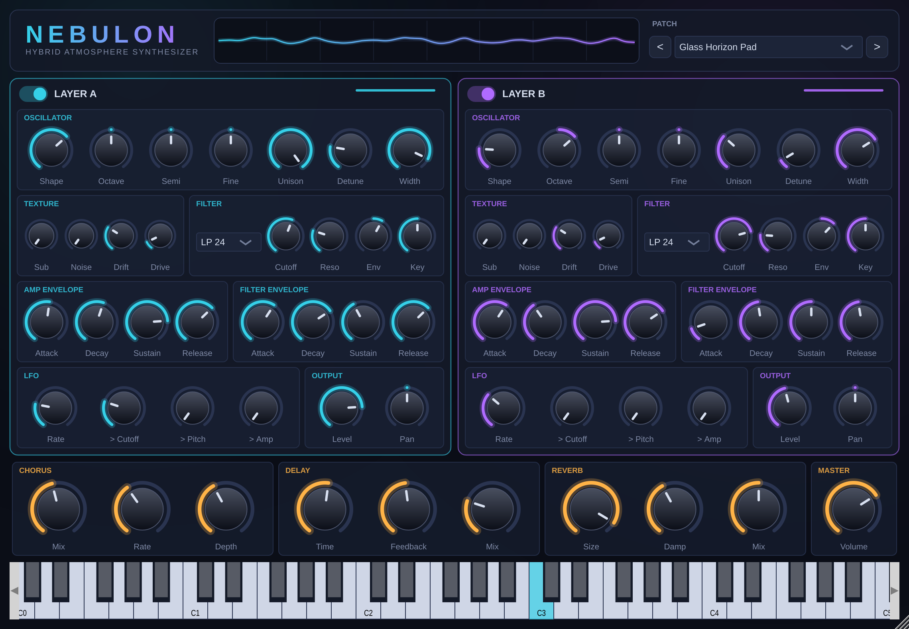

# Nebulon — Hybrid Atmosphere Synthesizer

An original, open-source polyphonic synth plugin (VST3 / AU / Standalone) for big
cinematic pads, evolving drones, analog-style strings and shimmering keys. It's in
the same broad category as high-end "atmospheric" hybrid synths, but all of its code,
sound engine, UI and presets are its own.



## Sound engine

- **Two layers (A + B)**, each a complete synth with its own on/off switch
- **Morphing oscillator**: Sine → Triangle → Saw → Square (PolyBLEP anti-aliased)
- **Unison up to 7 voices** with detune (cents) and stereo width
- **Texture**: sub oscillator, noise, *analog drift* (slow random pitch wander), drive
- **Filter**: zero-delay-feedback SVF with LP12 / LP24 / Band / High modes, resonance,
  envelope amount (bipolar) and key tracking
- **Two ADSRs per layer** (amp + filter)
- **LFO per layer** → cutoff, pitch (vibrato), amp (tremolo); the **mod wheel** deepens all LFO routings
- 16-voice polyphony, pitch bend ±2 semitones, velocity
- **FX rack**: stereo chorus → ping-pong tape-style delay → reverb → soft-clipping master

## Factory patches

Init Atmosphere, Glass Horizon Pad, Warm Analog Strings, Dark Matter Drone,
Crystal Pluck, Analog Brass Stack, Ethereal Choir, Deep Sub Bass, Shimmer Keys.
They also show up in your DAW's program list.

## Getting the plugin

**Easiest:** every push builds Windows, macOS and Linux binaries with GitHub Actions.
Open the repo's **Actions** tab → latest *Build* run → download `Nebulon-Windows`,
`Nebulon-macOS` or `Nebulon-Linux` from *Artifacts*.

Then copy `Nebulon.vst3` to:

| OS | VST3 folder |
|---|---|
| Windows | `C:\Program Files\Common Files\VST3\` |
| macOS | `~/Library/Audio/Plug-Ins/VST3/` (AU: `~/Library/Audio/Plug-Ins/Components/`) |
| Linux | `~/.vst3/` |

On macOS the build is unsigned; if it's blocked, run
`xattr -dr com.apple.quarantine ~/Library/Audio/Plug-Ins/VST3/Nebulon.vst3`.

The **Standalone** app runs without a DAW (use the on-screen keyboard or a MIDI controller).

## Building yourself

Requires CMake ≥ 3.22 and a C++17 compiler. JUCE 8 is downloaded automatically.

```bash
cmake -B build -DCMAKE_BUILD_TYPE=Release
cmake --build build --config Release
```

Output lands in `build/Nebulon_artefacts/Release/`. To use an existing JUCE checkout
pass `-DJUCE_DIR=/path/to/JUCE`. Add `-DNEBULON_BUILD_TESTS=ON` to build
`NebulonRenderTest`, which renders every preset to WAV and snapshots the UI.

## Project layout

```
Source/SynthVoice.h          DSP: oscillators, unison, filter, envelopes, LFO, voice
Source/PluginProcessor.*     parameters, synth, FX chain, presets/state
Source/Presets.h             factory patches
Source/PluginEditor.*        UI layout, oscilloscope
Source/NebulonLookAndFeel.h  knob / toggle styling
tools/RenderTest.cpp         offline smoke test
```

## License note

Built on [JUCE](https://juce.com), which is dual-licensed under AGPLv3 / commercial.
If you distribute binaries, either keep this project open source under AGPLv3 or
obtain a JUCE license.
