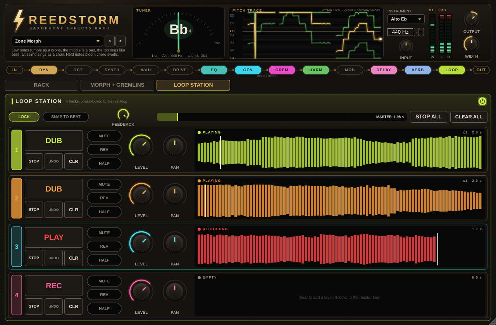
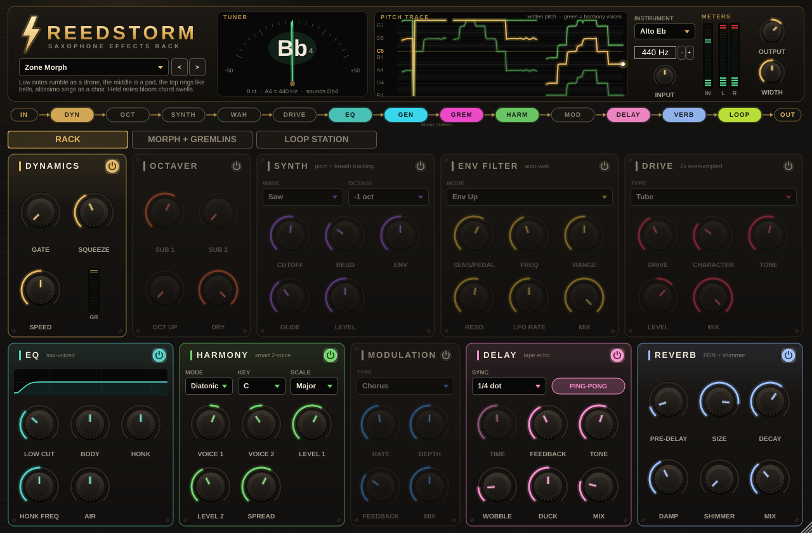

# Reedstorm: Saxophone Effects Rack (VST3 / AU / Standalone)

A 13-module effects rack built specifically for **saxophone**, with a 4-track loop station. It listens to your horn with a
pitch tracker, so it can show a **tuner** in your instrument's written key, add **in-key
harmonies**, drive a **synth voice that follows your playing**, keep the octaver locked to your note, and
**morph your sax into a different synth depending on which frequency you play**, with held notes
blooming into **generative patterns**. **Gremlins** listen for *any* sound (a note, a clap, a key click, your voice)
and answer with peculiar creatures, from cartoon boings to crushed industrial clanks. A **4-track loop station**
at the end of the chain lets you layer it all live.

| Morph + Gremlins | Loop Station |
|---|---|
|  |  |



## 🎧 Listen

Each clip is the same synthetic sax phrase run through one factory preset.
Start with the **[▶ dry phrase](demos/00_Dry_Sax.mp3)**.

| | | |
|---|---|---|
| [Studio Polish](demos/02_Studio_Polish.mp3) | [Smoky Jazz Club](demos/03_Smoky_Jazz_Club.mp3) | [Bright Pop Lead](demos/04_Bright_Pop_Lead.mp3) |
| [Funk Envelope Wah](demos/05_Funk_Envelope_Wah.mp3) | [Robot Talk Wah](demos/06_Robot_Talk_Wah.mp3) | [Octave Fuzz Monster](demos/07_Octave_Fuzz_Monster.mp3) |
| [Blues Shouter Growl](demos/08_Blues_Shouter_Growl.mp3) | [Sub Bass Sax](demos/09_Sub_Bass_Sax.mp3) | [Synth Horn Lead](demos/10_Synth_Horn_Lead.mp3) |
| [Square Wave Sax](demos/11_Square_Wave_Sax.mp3) | [Horn Section](demos/12_Horn_Section.mp3) | [Octave Unison](demos/13_Octave_Unison.mp3) |
| [Ethio Minor Section](demos/14_Ethio_Minor_Section.mp3) | [Ambient Shimmer](demos/15_Ambient_Shimmer.mp3) | [Dub Echo Chamber](demos/16_Dub_Echo_Chamber.mp3) |
| [Jet Flanger Space](demos/17_Jet_Flanger_Space.mp3) | [Rotary Club](demos/27_Rotary_Club.mp3) | [Lo-Fi Tape Memory](demos/28_Lo-Fi_Tape_Memory.mp3) |

**Morph Gen** (the sax changes into a different synth in each frequency zone, and held notes bloom):
[▶ Zone Morph](demos/18_Zone_Morph.mp3) ·
[▶ Bloom Bells](demos/19_Bloom_Bells.mp3) ·
[▶ Choir Ascension](demos/20_Choir_Ascension.mp3) ·
[▶ Swarm Machine](demos/21_Swarm_Machine.mp3) ·
[▶ Generative Ambient](demos/22_Generative_Ambient.mp3)

**Gremlins** (creatures spawned by every sound you make):
[▶ Gremlin Party](demos/23_Gremlin_Party.mp3) ·
[▶ Industrial Factory](demos/24_Industrial_Factory.mp3) ·
[▶ Cartoon Sax](demos/25_Cartoon_Sax.mp3) ·
[▶ Broken Robot](demos/26_Broken_Robot.mp3)

(The input is a synthesized saxophone, so expect the effects to sound better on a real horn.)

## The rack

```
IN ─ DYNAMICS ─ OCTAVER ─ SYNTH ─ ENV FILTER ─ DRIVE ─ EQ ─ MORPH GEN ─┬─ GREMLINS ─ HARMONY ─ MODULATION ─ DELAY ─ REVERB ─ LOOP STATION ─ OUT
     └──────────────── mono core (one voice) ─────────────────────┘  └──────────────────────────── stereo ─────────────────────────────┘
```

Click any module in the chain strip (or its power LED) to switch it on or off. Modules crossfade
in and out, so switching never clicks.

| Module | What it does |
|---|---|
| **Dynamics** | Noise gate for key clicks and breath between phrases, plus an opto-style compressor (*Squeeze*, *Speed*) with auto make-up and a GR meter |
| **Octaver** | Analog-style flip-flop divider (−1 and −2 octaves). Its input filter follows the tracked pitch, so it locks on cleanly. Also adds a pitch-synchronous octave up |
| **Synth** | A mono synth voice (Saw / Square / Saw+Sub / Soft) that follows your **pitch** and your **breath**: your dynamics drive the amp and the filter. Octave −2…+1, glide, resonance |
| **Env Filter** | Auto-wah: *Env Up*, *Env Down*, *LFO* or *Pedal* mode. In Pedal mode the SENS knob becomes the pedal position, so you can map it to an expression pedal or automate it |
| **Drive** | 2× oversampled **Tube**, **Fuzz** (with octave-up blend), **Growl** (the rough "hum while you blow" texture) and **Tape** |
| **EQ** | Sax-voiced: 24 dB/oct low cut, *Body* (210 Hz), *Honk* (sweepable 300 Hz to 5 kHz), *Air* shelf, with a live curve |
| **Harmony** | Two pitch-shifted voices. **Diatonic** mode stays in key (pick key and scale: Major, Minor, Dorian, Mixolydian, Harmonic Minor, Blues, both Pentatonics); **Chromatic** mode uses fixed intervals. Voices are panned with *Spread* |
| **Modulation** | Chorus, Flanger, Phaser (6-stage) and Rotary speaker |
| **Delay** | Tape echo, free or synced to the host tempo (1/2 to 1/16, dotted, triplet). Ping-pong, wobble (wow and flutter), a filtered and saturated feedback loop, and **ducking** so echoes stay out of the way while you play |
| **Reverb** | 8-line feedback-delay-network reverb with pre-delay, size, decay, damping and **Shimmer** (an octave-up feedback path for ambient pads) |

| **Morph Gen** | See below. Your frequency picks the synth, the sax morphs into it, and held notes bloom generative patterns |
| **Gremlins** | Any sound at the input spawns silly or harsh creatures. See below |
| **Loop Station** | 4 tracks that record the whole processed rack, locked to the first loop. See below |

### Morph Gen: a different synth for each frequency
The **zone map** splits your range into **4 frequency zones**. Drag the three split lines to set where each zone starts, from 60 Hz to 1.6 kHz, with the Hz and note name shown. Each zone has its own synth sound: **Bells** (FM), **Pad** (detuned saws), **Bowed** (physical-model string), **Drone** (sub-heavy sines), **Choir** (formant "aah") or **Swarm** (pulsing detuned saws).

- **Morph**: a synth voice follows your pitch and breath. **MORPH** blends sax (0%) to synth (100%). When you cross a split, the voice crossfades into the next zone's sound, so the timbre changes as you move around the horn. **PITCH>MORPH** makes higher (turn right) or lower (turn left) notes more synthetic, so a scale can sweep from pure sax to pure synth.
- **Bloom**: hold a note steady for **HOLD** ms and the zone it falls in triggers a **generative pattern** in that zone's sound. The pattern is built in the Harmony module's key and scale around the note you played. Patterns: **Arp Up**, **Random Walk**, **Chord Swell** and **Cascade**. Rate is synced to the host tempo (1/4 to 1/32 triplet), with **LENGTH**, **DENSITY** (how many steps play) and **RANGE** (1 to 3 octaves). **BLOOM!** fires one by hand. The zone flashes when a bloom triggers.

### Gremlins: peculiar creatures that answer any sound
An onset detector listens to the raw input for **any** sound: notes, breaths, claps, talking or key clicks. Each sound has a **CHANCE** of waking the gremlins, and **SWARM** sets how many come out.
- **Silly:** Boing (cartoon spring), Pew Pew (lasers), Quack, Bubbles, Beep-Boop (a bit-crushed robot), Wheee (slide whistle), Bzzzt (your last phrase through a kazoo).
- **Harsh / industrial:** Clank (struck metal bar), Grrrzzt (comb-filtered grinder through a wavefolder), St-st-stutter (a slice of what you just played, retriggered and crushed), Esrever (your sound backwards and ring-modulated), Skreeee (runaway feedback), Ksshhh (static).
- **SILLY<>HARSH** sets the mix between the two families. **DIRT** sends the whole gremlin bus through a clipper, then a bit crusher, then a sample-rate reducer. **FOLLOW** makes the creatures use the pitch you're playing. **SENS** sets how easily they wake up. **SPAWN!** summons one by hand.
- The terrarium on the right shows each creature as it appears: round smiling ones for silly, spiky angry ones for harsh.

### Loop Station: 4 tracks
Each track has one footswitch button that goes **REC**, then **PLAY** (the loop closes), then **DUB** (overdub), then **PLAY**, and so on. Each track also has **STOP**, **UNDO** (removes the last overdub, press again to redo), **CLR**, **MUTE**, **REV** (reverse), **HALF** speed, **LEVEL** and **PAN**, plus its own waveform.
- **LOCK** (on by default): the first loop you close becomes the **master**. When you close any other track, it keeps recording until the next whole multiple of the master, so a 1.4-bar phrase becomes 2 bars. Tracks stay phase-locked, even after STOP and restart, so layers never drift. The master bar shows where you are in the loop.
- **SNAP TO BEAT** rounds the master loop to whole beats of the host tempo. **FEEDBACK** sets how much of the older layers survives each overdub. **STOP ALL** and **CLEAR ALL** act on every track.
- Each track can hold up to 25 s at 48 kHz.
- For hands-free use, these are host parameters you can MIDI-learn to a foot controller: *Track N Rec/Play/Dub*, *Stop*, *Undo* and *Clear*, plus *Loop Stop All* and *Loop Clear All*.

The window has three tabs: **RACK**, **MORPH + GREMLINS** and **LOOP STATION**. The signal chain strip stays visible on every tab, so you can switch any module on or off from anywhere.

**Header:** factory preset browser, **tuner**, **pitch trace** (a scrolling piano roll of what you play; with Harmony on it also draws the harmony voices in green), input gain, output gain, stereo width, and IN / L / R meters. A safety limiter on the output stops overs.

### Tuner and transposition
Pick your horn in **Instrument** (Concert C, Soprano B♭, Alto E♭, Tenor B♭, Bari E♭). The tuner and pitch trace then show **written** notes (with the sounding note underneath), and the Harmony **Key** is also in written pitch. On alto, "C major" means the C major you read. The reference pitch (A4) is adjustable from 430 to 450 Hz.

### Tips
- Use a close mic or a clip-on mic for best tracking. Feed the plugin a **dry**, single-voice signal.
- Harmony and Synth follow the note you play. Very breathy or growled notes can't be tracked, so the harmony keeps its last interval.
- Use the Delay's *Duck* control: a lot of echo between phrases while staying clean while you play.
- Most knobs show their value while hovered. Double-click any knob to reset it.

## Factory presets (28)
**Basics:** Init, Studio Polish, Smoky Jazz Club, Bright Pop Lead ·
**Funk:** Funk Envelope Wah, Robot Talk Wah ·
**Heavy:** Octave Fuzz Monster, Blues Shouter Growl, Sub Bass Sax ·
**Synth:** Synth Horn Lead, Square Wave Sax ·
**Harmony:** Horn Section, Octave Unison, Ethio Minor Section ·
**Space:** Ambient Shimmer, Dub Echo Chamber, Jet Flanger Space ·
**Morph:** Zone Morph, Bloom Bells, Choir Ascension, Swarm Machine, Generative Ambient ·
**Gremlins:** Gremlin Party, Industrial Factory, Cartoon Sax, Broken Robot ·
**Vintage:** Rotary Club, Lo-Fi Tape Memory

Presets are level-matched and also appear in your DAW's program list. Your input gain, output
gain, tuner settings and your loops are kept when you switch presets.

## Getting the plugin
GitHub Actions builds Windows, macOS and Linux binaries on every push. Open the **Actions** tab, choose the latest
**Build Reedstorm** run, and download `Reedstorm-<OS>` from *Artifacts*. Copy `Reedstorm.vst3` to:

| OS | VST3 folder |
|---|---|
| Windows | `C:\Program Files\Common Files\VST3\` |
| macOS | `~/Library/Audio/Plug-Ins/VST3/` (AU: `~/Library/Audio/Plug-Ins/Components/`) |
| Linux | `~/.vst3/` |

On macOS the build is unsigned. If macOS blocks it, run `xattr -dr com.apple.quarantine ~/Library/Audio/Plug-Ins/VST3/Reedstorm.vst3`.
The **Standalone** app lets you plug a mic into your audio interface and play without a DAW.

## Building it yourself
You need CMake 3.22 or newer and a C++17 compiler. JUCE 8 is downloaded automatically.

```bash
cd SaxRack
cmake -B build -DCMAKE_BUILD_TYPE=Release
cmake --build build --config Release
```

The output goes to `build/Reedstorm_artefacts/Release/`. Pass `-DJUCE_DIR=/path/to/JUCE` to use a local JUCE.
Add `-DREEDSTORM_BUILD_TESTS=ON` to also build `ReedstormRenderTest <dir> [--demos]`, which:

- checks the pitch tracker over the full sax range (bari low A to soprano altissimo) at 44.1, 48 and 96 kHz
- checks that every Morph Gen sound follows the played pitch, that a held note blooms in the right zone, that the loop station repeats exactly, that overdub/undo/redo restore the right layers, and that a second track locks to a whole multiple of the master and stays on its grid after stop and restart
- checks that the gremlins catch 40 out of 40 claps, that silly mode only spawns silly creatures (and harsh mode only harsh ones), and that every kind of creature appears and renders cleanly
- checks that the pitch shifter and harmony voices are in tune (within a few cents), the octaver divides correctly, and the diatonic and transposed-key logic gives the right intervals
- renders every preset (NaN, silence, clipping and CPU checks; uses mono and stereo inputs) and snapshots the UI
- with `--demos`, writes the WAVs behind `demos/`

## Source layout
```
Source/Rack.*            the signal chain (all DSP modules)
Source/Generator.h       Morph Gen: frequency zones, morph voice, generative bloom
Source/Voice.h           the six Morph Gen synth sounds
Source/Looper.h          4-track loop station with master-loop lock (allocation-free, spike-free undo)
Source/Gremlins.h        onset detector + 13 creature sounds + DIRT bus
Source/GenLoopUI.h       zone map, Morph Gen, Gremlins terrarium and Loop Station panels
Source/PitchTracker.h    YIN pitch tracker (decimated, cheap enough for the audio thread)
Source/DSP.h             SVF, biquad, delay line, pitch-synchronous pitch shifter, helpers
Source/Params.h          parameters, scales, instrument transpositions
Source/Presets.h         factory presets
Source/PluginProcessor.* plugin wrapper, presets, state
Source/PluginEditor.*    window layout (scales to any window size)
Source/Widgets.h         knobs, module panels, tuner, pitch trace, EQ curve, chain strip, meters
Source/LookAndFeel.h     styling
tools/RenderTest.cpp     tests and demo renderer
```

## License note
Built on [JUCE](https://juce.com), which is dual-licensed under AGPLv3 and a commercial license. If you distribute binaries,
keep this project open source under AGPLv3 or get a JUCE license.
