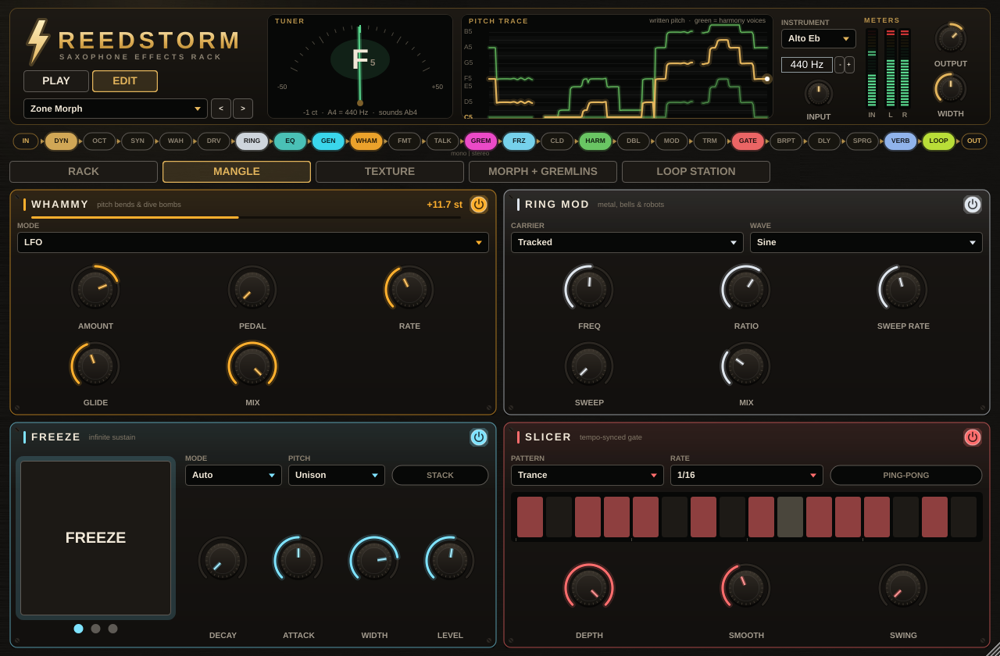
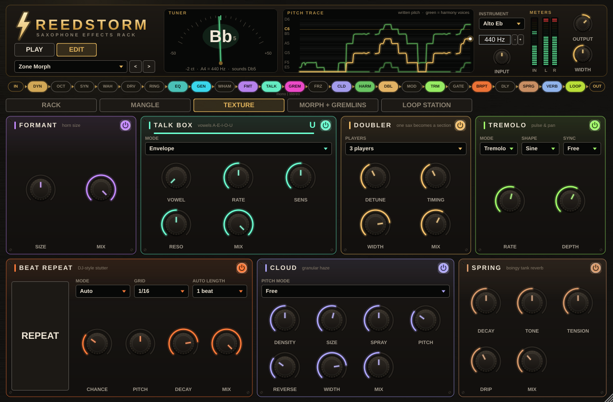
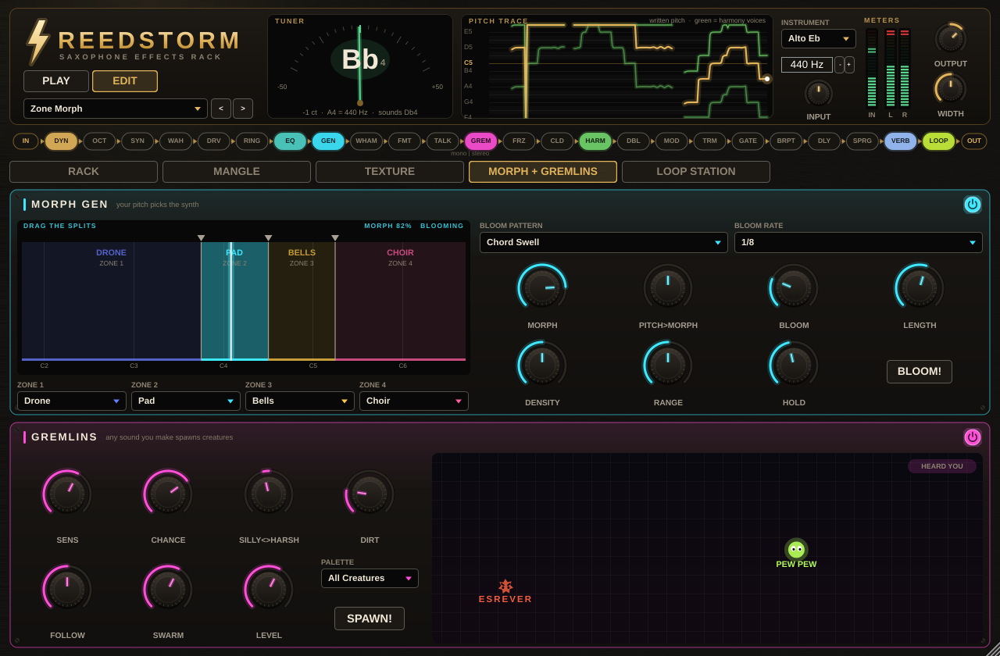
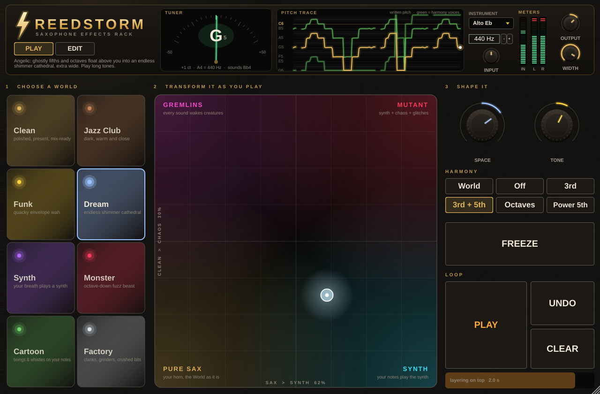

# Reedstorm: Saxophone Effects Rack (VST3 / AU / Standalone)

A 24-module effects rack built specifically for **saxophone**, with a 4-track loop station. It listens to your horn with a
pitch tracker, so it can show a **tuner** in your instrument's written key, add **in-key
harmonies**, drive a **synth voice that follows your playing**, keep the octaver locked to your note, and
**morph your sax into a different synth depending on which frequency you play**, with held notes
blooming into **generative patterns**. **Gremlins** listen for *any* sound (a note, a clap, a key click, your voice)
and answer with peculiar creatures, from cartoon boings to crushed industrial clanks. A **4-track loop station**
at the end of the chain lets you layer it all live.

| Mangle | Texture |
|---|---|
|  |  |
| **Morph + Gremlins** | **Loop Station** |
|  |  |



## Start here: the PLAY screen
Reedstorm opens on a simple screen with three steps:

1. **Choose a World**: Clean, Jazz Club, Funk, Dream, Synth, Monster, Cartoon or Factory.
2. **Transform it as you play** with one pad. Left to right turns your sax into a synth (the Morph engine); bottom to top goes from clean to chaos (gremlins, then fuzz, then beat-repeat glitches). Double-click the pad to return to the pure World. The pad is automatable and works well on an XY controller or an expression pedal.
3. **Shape it**: **SPACE** (drier, or room, then echoes, then an endless shimmer), **TONE** (dark to bright), **HARMONY** (World / Off / 3rd / 3rd + 5th / Octaves / Power 5th), a big **FREEZE** button and a one-button **LOOP** (record, play, layer, undo, clear).

These controls bend whatever World is loaded without overwriting it. **EDIT** in the header opens the full rack: all 24 modules, the 4-track Loop Station and all 43 presets. Nothing was removed.


## 🎧 Listen

Each clip is the same synthetic sax phrase run through one factory preset.
Start with the **[▶ dry phrase](demos/00_Dry_Sax.mp3)**. The input is a synthesized saxophone, so expect the effects to sound better on a real horn.

**Basics:** [▶ Studio Polish](demos/02_Studio_Polish.mp3) · [▶ Smoky Jazz Club](demos/03_Smoky_Jazz_Club.mp3) · [▶ Bright Pop Lead](demos/04_Bright_Pop_Lead.mp3)

**Funk:** [▶ Funk Envelope Wah](demos/05_Funk_Envelope_Wah.mp3) · [▶ Robot Talk Wah](demos/06_Robot_Talk_Wah.mp3)

**Heavy:** [▶ Octave Fuzz Monster](demos/07_Octave_Fuzz_Monster.mp3) · [▶ Blues Shouter Growl](demos/08_Blues_Shouter_Growl.mp3) · [▶ Sub Bass Sax](demos/09_Sub_Bass_Sax.mp3) · [▶ 8-Bit Crush](demos/10_8-Bit_Crush.mp3) · [▶ Wavefolder Scream](demos/11_Wavefolder_Scream.mp3)

**Synth:** [▶ Synth Horn Lead](demos/12_Synth_Horn_Lead.mp3) · [▶ Square Wave Sax](demos/13_Square_Wave_Sax.mp3)

**Harmony:** [▶ Horn Section](demos/14_Horn_Section.mp3) · [▶ Octave Unison](demos/15_Octave_Unison.mp3) · [▶ Ethio Minor Section](demos/16_Ethio_Minor_Section.mp3)

**Space:** [▶ Ambient Shimmer](demos/17_Ambient_Shimmer.mp3) · [▶ Dub Echo Chamber](demos/18_Dub_Echo_Chamber.mp3) · [▶ Jet Flanger Space](demos/19_Jet_Flanger_Space.mp3)

**Morph:** [▶ Zone Morph](demos/20_Zone_Morph.mp3) · [▶ Bloom Bells](demos/21_Bloom_Bells.mp3) · [▶ Choir Ascension](demos/22_Choir_Ascension.mp3) · [▶ Swarm Machine](demos/23_Swarm_Machine.mp3) · [▶ Generative Ambient](demos/24_Generative_Ambient.mp3)

**Texture:** [▶ Sax Section Double](demos/25_Sax_Section_Double.mp3) · [▶ Giant Bass Sax](demos/26_Giant_Bass_Sax.mp3) · [▶ Sopranino Squeak](demos/27_Sopranino_Squeak.mp3) · [▶ Talking Sax](demos/28_Talking_Sax.mp3) · [▶ Surf Spring Tremolo](demos/29_Surf_Spring_Tremolo.mp3) · [▶ Granular Haze](demos/30_Granular_Haze.mp3) · [▶ Beat Repeat Glitch](demos/31_Beat_Repeat_Glitch.mp3)

**Gremlins:** [▶ Gremlin Party](demos/32_Gremlin_Party.mp3) · [▶ Industrial Factory](demos/33_Industrial_Factory.mp3) · [▶ Cartoon Sax](demos/34_Cartoon_Sax.mp3) · [▶ Broken Robot](demos/35_Broken_Robot.mp3)

**Mangle:** [▶ Whammy Dive Bomb](demos/36_Whammy_Dive_Bomb.mp3) · [▶ Jazz Scoops](demos/37_Jazz_Scoops.mp3) · [▶ Ring Mod Robot](demos/38_Ring_Mod_Robot.mp3) · [▶ Bell Ring](demos/39_Bell_Ring.mp3) · [▶ Freeze & Solo](demos/40_Freeze_and_Solo.mp3) · [▶ Trance Gate Sax](demos/41_Trance_Gate_Sax.mp3)

**Vintage:** [▶ Rotary Club](demos/42_Rotary_Club.mp3) · [▶ Lo-Fi Tape Memory](demos/43_Lo-Fi_Tape_Memory.mp3)

## The rack

```
IN ─ DYNAMICS ─ OCTAVER ─ SYNTH ─ ENV FILTER ─ DRIVE ─ RING MOD ─ EQ ─ MORPH GEN ─ WHAMMY ─ FORMANT ─ TALK BOX ─┐
     └──────────────────────────────────── mono core (one voice) ──────────────────────────────────────┘ │
   ┌───────────────────────────────────────────────────────────────────────────────────────────────────────┘
   └─ GREMLINS ─ FREEZE ─ CLOUD ─ HARMONY ─ DOUBLER ─ MODULATION ─ TREMOLO ─ SLICER ─ BEAT REPEAT
        ─ DELAY ─ SPRING ─ REVERB ─ LOOP STATION ─ OUT   (stereo)
```

Click any module in the chain strip (or its power LED) to switch it on or off. Modules crossfade
in and out, so switching never clicks.

| Module | What it does |
|---|---|
| **Dynamics** | Noise gate for key clicks and breath between phrases, plus an opto-style compressor (*Squeeze*, *Speed*) with auto make-up and a GR meter |
| **Octaver** | Analog-style flip-flop divider (−1 and −2 octaves). Its input filter follows the tracked pitch, so it locks on cleanly. Also adds a pitch-synchronous octave up |
| **Synth** | A mono synth voice (Saw / Square / Saw+Sub / Soft) that follows your **pitch** and your **breath**: your dynamics drive the amp and the filter. Octave −2…+1, glide, resonance |
| **Env Filter** | Auto-wah: *Env Up*, *Env Down*, *LFO* or *Pedal* mode. In Pedal mode the SENS knob becomes the pedal position, so you can map it to an expression pedal or automate it |
| **Drive** | 2× oversampled **Tube**, **Fuzz** (with octave-up blend), **Growl** (the rough "hum while you blow" texture), **Tape**, **Bitcrush** (fewer bits with DRIVE, lower sample rate with CHARACTER), **Wavefold** (the harder you play, the more the wave folds back on itself) and **Rectify** (full-wave octave snarl) |
| **EQ** | Sax-voiced: 24 dB/oct low cut, *Body* (210 Hz), *Honk* (sweepable 300 Hz to 5 kHz), *Air* shelf, with a live curve |
| **Harmony** | Two pitch-shifted voices. **Diatonic** mode stays in key (pick key and scale: Major, Minor, Dorian, Mixolydian, Harmonic Minor, Blues, both Pentatonics); **Chromatic** mode uses fixed intervals. Voices are panned with *Spread* |
| **Modulation** | Chorus, Flanger, Phaser (6-stage) and Rotary speaker |
| **Delay** | Tape echo, free or synced to the host tempo (1/2 to 1/16, dotted, triplet). Ping-pong, wobble (wow and flutter), a filtered and saturated feedback loop, and **ducking** so echoes stay out of the way while you play |
| **Reverb** | 8-line feedback-delay-network reverb with pre-delay, size, decay, damping and **Shimmer** (an octave-up feedback path for ambient pads) |

| **Morph Gen** | See below. Your frequency picks the synth, the sax morphs into it, and held notes bloom generative patterns |
| **Ring Mod** | Multiplies your sound by a carrier. **Tracked** mode sets the carrier to your note × RATIO (whole ratios ring like bells, odd ones clang like metal). **Fixed** mode uses a fixed frequency for robot and Dalek voices. Sine, square or triangle carrier, with a slow up/down sweep |
| **Whammy** | Pitch bend up to ±24 semitones on everything above it in the chain. **Pedal** (map PEDAL to an expression pedal), **LFO** (dive-bombs and rises), **Scoop** (every new note slides in from below or above, like a bebop scoop or a fall) and **Random** (stepped jumps). Uses the same in-tune pitch shifter as Harmony |
| **Formant** | Changes the *size* of the horn without changing the pitch: a giant bass sax or a tiny sopranino. Pitch-synchronous grains are re-spaced at your note's period, using the pitch tracker. Adds about 25 ms of delay while on |
| **Talk Box** | Three resonant vowel filters glide through A-E-I-O-U, driven by a knob (**Manual**), an **LFO**, your playing level (**Envelope**: soft = "oo", loud = "ah") or **Random** |
| **Gremlins** | Any sound at the input spawns silly or harsh creatures. See below |
| **Freeze** | Granular infinite sustain: a 0.4 s slice of your sound plays back as an endless, shimmering pad made of overlapping grains. **Manual**: press FREEZE, press again to release; STACK adds layers instead of replacing. **Auto**: every steadily held new note freezes itself and stacks, up to 3 layers. PITCH (−1 oct, unison, +5th, +1 oct), DECAY (0 = forever), ATTACK, WIDTH |
| **Cloud** | Granular haze: sprays short fragments of the last ~2 s, re-pitched (**Free**, **Octaves** or **Fifths**), some reversed, across the stereo field. DENSITY, SIZE, SPRAY, PITCH, REVERSE, WIDTH |
| **Doubler** | Turns one sax into 2-4 players. Each copy comes in a little late and drifts slightly out of tune (classic double-tracking), panned wide |
| **Tremolo** | **Tremolo**, **Auto-Pan** or vintage **Harmonic** tremolo (lows and highs pulse in opposition). Sine, triangle or square, free-running or synced from 1/2 to 1/16 |
| **Beat Repeat** | DJ-style stutter of the last 1/4 to 1/32 (triplets too), synced to the host. Each repeat can pitch down (tape-stop dive) or up and fade. **Manual**: hold REPEAT. **Auto**: random repeats on the beat, with CHANCE and LENGTH |
| **Spring** | Spring-tank reverb: 28 dispersive allpass filters inside a feedback delay give the classic "boing" chirp. DECAY, TONE, TENSION, DRIP (how hard attacks splash) |
| **Slicer** | Tempo-synced gate that follows the host transport. Patterns: Trance, Offbeat, Stutter, Half-time, Chop, Morse and Random (a new pattern every bar). Steps of 1/8 to 1/32 including triplets, DEPTH, SMOOTH (hard chop to soft pulse), SWING and PING-PONG (alternating left and right) |
| **Loop Station** | 4 tracks that record the whole processed rack, locked to the first loop. See below |

### Morph Gen: a different synth for each frequency
The **zone map** splits your range into **4 frequency zones**. Drag the three split lines to set where each zone starts, from 60 Hz to 1.6 kHz, with the Hz and note name shown. Each zone has its own synth sound: **Bells** (FM), **Pad** (detuned saws), **Bowed** (physical-model string), **Drone** (sub-heavy sines), **Choir** (formant "aah") or **Swarm** (pulsing detuned saws).

- **Morph**: a synth voice follows your pitch and breath. **MORPH** blends sax (0%) to synth (100%). When you cross a split, the voice crossfades into the next zone's sound, so the timbre changes as you move around the horn. **PITCH>MORPH** makes higher (turn right) or lower (turn left) notes more synthetic, so a scale can sweep from pure sax to pure synth.
- **Bloom**: hold a note steady for **HOLD** ms and the zone it falls in triggers a **generative pattern** in that zone's sound. The pattern is built in the Harmony module's key and scale around the note you played. Patterns: **Arp Up**, **Random Walk**, **Chord Swell** and **Cascade**. Rate is synced to the host tempo (1/4 to 1/32 triplet), with **LENGTH**, **DENSITY** (how many steps play) and **RANGE** (1 to 3 octaves). **BLOOM!** fires one by hand. The zone flashes when a bloom triggers.

### Gremlins: peculiar creatures that answer any sound
An onset detector listens to the raw input for **any** sound: notes, breaths, claps, talking or key clicks. Each sound has a **CHANCE** of waking the gremlins, and **SWARM** sets how many come out.
- **Silly:** Boing (cartoon spring), Pew Pew (lasers), Quack, Bubbles, Beep-Boop (a bit-crushed robot), Wheee (slide whistle), Bzzzt (your last phrase through a kazoo).
- **Harsh / industrial:** Clank (struck metal bar), Grrrzzt (comb-filtered grinder through a wavefolder), St-st-stutter (a slice of what you just played, retriggered and crushed), Esrever (your sound backwards and ring-modulated), Skreeee (runaway feedback), Ksshhh (static).
- **PALETTE** picks the cast. **All Creatures**; **Cartoon** (boing, whistle, bubbles, quack); **Sci-Fi** (pew, robot, screech, static); **Voice Mangler** (kazoo, stutter, reverse ghost, quack); **Scrapyard** (clank, grinder, static, stutter).
- **SILLY<>HARSH** sets the mix between the two families. **DIRT** sends the whole gremlin bus through a clipper, then a bit crusher, then a sample-rate reducer. **FOLLOW** makes the creatures use the pitch you're playing. **SENS** sets how easily they wake up. **SPAWN!** summons one by hand.
- The terrarium on the right shows each creature as it appears: round smiling ones for silly, spiky angry ones for harsh.

### Loop Station: 4 tracks
Each track has one footswitch button that goes **REC**, then **PLAY** (the loop closes), then **DUB** (overdub), then **PLAY**, and so on. Each track also has **STOP**, **UNDO** (removes the last overdub, press again to redo), **CLR**, **MUTE**, **REV** (reverse), **HALF** speed, **LEVEL** and **PAN**, plus its own waveform.
- **LOCK** (on by default): the first loop you close becomes the **master**. When you close any other track, it keeps recording until the next whole multiple of the master, so a 1.4-bar phrase becomes 2 bars. Tracks stay phase-locked, even after STOP and restart, so layers never drift. The master bar shows where you are in the loop.
- **SNAP TO BEAT** rounds the master loop to whole beats of the host tempo. **FEEDBACK** sets how much of the older layers survives each overdub. **STOP ALL** and **CLEAR ALL** act on every track.
- Each track can hold up to 25 s at 48 kHz.
- For hands-free use, these are host parameters you can MIDI-learn to a foot controller: *Track N Rec/Play/Dub*, *Stop*, *Undo* and *Clear*, plus *Loop Stop All* and *Loop Clear All*.

The window opens on **PLAY**. **EDIT** has five tabs: **RACK**, **MANGLE**, **TEXTURE**, **MORPH + GREMLINS** and **LOOP STATION**. The signal chain strip stays visible on every tab, so you can switch any module on or off from anywhere.

**Header:** factory preset browser, **tuner**, **pitch trace** (a scrolling piano roll of what you play; with Harmony on it also draws the harmony voices in green), input gain, output gain, stereo width, and IN / L / R meters. A safety limiter on the output stops overs.

### Tuner and transposition
Pick your horn in **Instrument** (Concert C, Soprano B♭, Alto E♭, Tenor B♭, Bari E♭). The tuner and pitch trace then show **written** notes (with the sounding note underneath), and the Harmony **Key** is also in written pitch. On alto, "C major" means the C major you read. The reference pitch (A4) is adjustable from 430 to 450 Hz.

### Tips
- Use a close mic or a clip-on mic for best tracking. Feed the plugin a **dry**, single-voice signal.
- Harmony and Synth follow the note you play. Very breathy or growled notes can't be tracked, so the harmony keeps its last interval.
- Use the Delay's *Duck* control: a lot of echo between phrases while staying clean while you play.
- Most knobs show their value while hovered. Double-click any knob to reset it.

## Factory presets (43)
**Basics:** Init, Studio Polish, Smoky Jazz Club, Bright Pop Lead ·
**Funk:** Funk Envelope Wah, Robot Talk Wah ·
**Heavy:** Octave Fuzz Monster, Blues Shouter Growl, Sub Bass Sax, 8-Bit Crush, Wavefolder Scream ·
**Synth:** Synth Horn Lead, Square Wave Sax ·
**Harmony:** Horn Section, Octave Unison, Ethio Minor Section ·
**Space:** Ambient Shimmer, Dub Echo Chamber, Jet Flanger Space ·
**Morph:** Zone Morph, Bloom Bells, Choir Ascension, Swarm Machine, Generative Ambient ·
**Texture:** Sax Section Double, Giant Bass Sax, Sopranino Squeak, Talking Sax, Surf Spring Tremolo, Granular Haze, Beat Repeat Glitch ·
**Gremlins:** Gremlin Party, Industrial Factory, Cartoon Sax, Broken Robot ·
**Mangle:** Whammy Dive Bomb, Jazz Scoops, Ring Mod Robot, Bell Ring, Freeze & Solo, Trance Gate Sax ·
**Vintage:** Rotary Club, Lo-Fi Tape Memory

Each preset is built around one main effect, so presets sound clearly different both within a bank and across banks. This is checked with a similarity measure on the demo renders that compares timbre over time, harmony (pitch classes), modulation and roughness, stereo image and reverb tail. Presets are level-matched and also appear in your DAW's program list. Your input gain, output
gain, tuner settings and your loops are kept when you switch presets.

## Getting the plugin
GitHub Actions builds Windows, macOS and Linux binaries on every push. Open the **Actions** tab, choose the latest
**Build Reedstorm** run, and download `Reedstorm-<OS>` from *Artifacts*. Copy `Reedstorm.vst3` to:

| OS | VST3 folder |
|---|---|
| Windows | `C:\Program Files\Common Files\VST3\` |
| macOS | `~/Library/Audio/Plug-Ins/VST3/` (AU: `~/Library/Audio/Plug-Ins/Components/`) |
| Linux | `~/.vst3/` |

On macOS the build is unsigned. If macOS blocks it, run `xattr -dr com.apple.quarantine ~/Library/Audio/Plug-Ins/VST3/Reedstorm.vst3`.
The **Standalone** app lets you plug a mic into your audio interface and play without a DAW.

## Building it yourself
You need CMake 3.22 or newer and a C++17 compiler. JUCE 8 is downloaded automatically.

```bash
cd SaxRack
cmake -B build -DCMAKE_BUILD_TYPE=Release
cmake --build build --config Release
```

The output goes to `build/Reedstorm_artefacts/Release/`. Pass `-DJUCE_DIR=/path/to/JUCE` to use a local JUCE.
Add `-DREEDSTORM_BUILD_TESTS=ON` to also build `ReedstormRenderTest <dir> [--demos]`, which:

- checks the pitch tracker over the full sax range (bari low A to soprano altissimo) at 44.1, 48 and 96 kHz
- checks that every Morph Gen sound follows the played pitch, that a held note blooms in the right zone, that the loop station repeats exactly, that overdub/undo/redo restore the right layers, and that a second track locks to a whole multiple of the master and stays on its grid after stop and restart
- checks that the gremlins catch 40 out of 40 claps, that silly mode only spawns silly creatures (and harsh mode only harsh ones), and that every kind of creature appears and renders cleanly
- checks that the pitch shifter and harmony voices are in tune (within a few cents), the octaver divides correctly, and the diatonic and transposed-key logic gives the right intervals
- renders every preset (NaN, silence, clipping and CPU checks; uses mono and stereo inputs) and snapshots the UI
- with `--demos`, writes the WAVs behind `demos/`

## Source layout
```
Source/Rack.*            the signal chain (all DSP modules)
Source/Generator.h       Morph Gen: frequency zones, morph voice, generative bloom
Source/Voice.h           the six Morph Gen synth sounds
Source/Looper.h          4-track loop station with master-loop lock (allocation-free, spike-free undo)
Source/Gremlins.h        onset detector + 13 creature sounds + DIRT bus
Source/Mangle.h          Whammy, Ring Mod, Freeze (granular), Slicer (tempo gate)
Source/MangleUI.h        Mangle page panels (bend readout, FREEZE button, step grid)
Source/Texture.h         Formant, Talk Box, Doubler, Tremolo, Beat Repeat, Spring, Cloud
Source/PlayUI.h          PLAY screen: Worlds, Transform pad, Space/Tone/Harmony, Freeze, Loop
Source/TextureUI.h       Texture page panels
Source/GenLoopUI.h       zone map, Morph Gen, Gremlins terrarium and Loop Station panels
Source/PitchTracker.h    YIN pitch tracker (decimated, cheap enough for the audio thread)
Source/DSP.h             SVF, biquad, delay line, pitch-synchronous pitch shifter, helpers
Source/Params.h          parameters, scales, instrument transpositions
Source/Presets.h         factory presets
Source/PluginProcessor.* plugin wrapper, presets, state
Source/PluginEditor.*    window layout (scales to any window size)
Source/Widgets.h         knobs, module panels, tuner, pitch trace, EQ curve, chain strip, meters
Source/LookAndFeel.h     styling
tools/RenderTest.cpp     tests and demo renderer
```

## License note
Built on [JUCE](https://juce.com), which is dual-licensed under AGPLv3 and a commercial license. If you distribute binaries,
keep this project open source under AGPLv3 or get a JUCE license.
